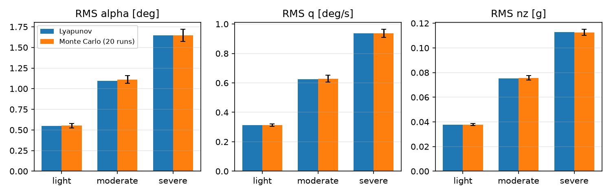
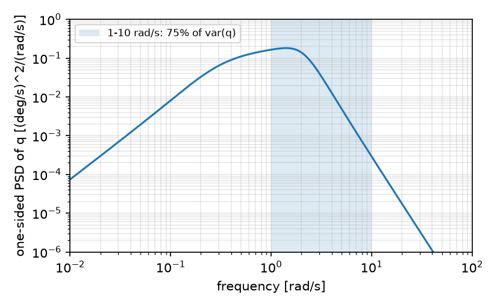
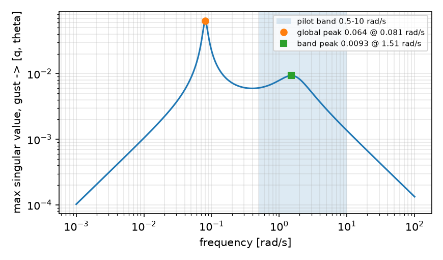

# Dryden–Lyapunov Toolbox

Dryden atmospheric turbulence (MIL-F-8785C / MIL-HDBK-1797) as state-space shaping filters, plus **steady-state RMS of any linear aircraft model by solving one Lyapunov equation**, with a Monte Carlo cross-check and band-limited variance (e.g. the pilot's 1–10 rad/s band).

Since v0.2 it also has an **MLST module** (Multivariable Linear Systems Theory) for open-loop disturbance susceptibility: which modes the gusts reach, which ones show up in the pilot's outputs, and where the worst-case amplification sits in frequency.

Same API in **Python** and **MATLAB/GNU Octave**. Both versions are tested and give identical Lyapunov results.



## Why

Gust response is usually estimated by running many long time simulations and averaging. For a linear (or linearized) model that is unnecessary: append the turbulence filters to the plant, solve

$$A_a P + P A_a^\top + B_a W B_a^\top = 0$$

and read the RMS of every state and output from the diagonal of $C_a P C_a^\top$. One solve replaces hundreds of seconds of simulation, with no seed scatter. The Monte Carlo routine is there to prove it, and to check that the linear model still holds when you compare against a nonlinear simulation of your own.

## What's inside

| Function (Python / MATLAB) | What it does |
|---|---|
| `dryden_params` | Scale lengths L and intensities σ for airspeed V and altitude h: low altitude from W20 (light/moderate/severe = 15/30/45 kt), L = 1750 ft above 2000 ft, linear blend in between |
| `dryden_ss` | Block-diagonal state space of the u, v, w filters (5 states) |
| `augment` / `dl_augment` | Appends the filters to a plant `x' = A x + Bg g`, `y = C x + Dg g` |
| `lyapunov_rms` / `lyap_rms` | Steady-state RMS of every output from the Lyapunov equation |
| `monte_carlo_rms` / `mc_rms` | Time-domain RMS over N seeds, exact (Van Loan) discretization of the noise |
| `band_variance` (Python) | Fraction of each output's variance inside a frequency band, from the one-sided PSD |
| `gramians` / `mlst_gramians` | Controllability and observability Gramians (with an automatic shift for marginal modes such as integrators) |
| `modal_table` / `mlst_modal` | Per mode: wn, ζ, modal reachability from the gusts, visibility in the outputs, a combined index and the dominant state |
| `hankel_sv`, `h2_norm`, `hinf_norm` / `mlst_norms` | Hankel singular values, H2 norm, H∞ peak and its frequency, globally and inside a band (e.g. 0.5–10 rad/s) |

## Quick start

**Python** (numpy, scipy, matplotlib)

```bash
cd python
pip install -r requirements.txt
python examples/short_period_example.py   # Dryden RMS: Lyapunov vs Monte Carlo
python examples/mlst_example.py           # modal susceptibility, H2, H∞
python -m pytest -q tests                 # 24 tests
```

```python
import numpy as np
from drydenlyap import dryden_params, augment, lyapunov_rms

p = dryden_params(V=80.0, h=300.0, intensity="moderate")
Aa, Ba, Ca = augment(A, Bg, C, p, Dg)      # your linear model, Bg columns = [u_g, v_g, w_g]
rms = lyapunov_rms(Aa, Ba, Ca)
```

**MATLAB or GNU Octave** (core functions only, no toolboxes)

```matlab
cd matlab
run_tests               % PASS/FAIL checks
example_short_period    % same case as the Python example
example_mlst            % MLST module, same case as python/examples/mlst_example.py
```

## Noise convention (the factor-of-2 trap)

The filters are written in the handbook form

- $H_u(s) = \sigma_u \sqrt{\dfrac{2L_u}{\pi V}} \dfrac{1}{1 + (L_u/V)s}$
- $H_{v,w}(s) = \sigma \sqrt{\dfrac{L}{\pi V}} \dfrac{1 + \sqrt{3}(L/V)s}{(1 + (L/V)s)^2}$

which assume a **one-sided** spectrum. Driven by continuous white noise of intensity **W = π** (spectral density W/2π, two-sided), each filter output has variance exactly σ². This is the toolbox default (`NOISE_INTENSITY = pi`), and the tests check it at every altitude band and intensity.

If your book or block diagram uses unit intensity, or a two-sided convention, your RMS will differ by √2 or √π. That is a convention mismatch, not an error in the source. In Simulink, a *Band-Limited White Noise* block with *Noise power* = π and sample time dt reproduces this convention.

## Example result

Generic short-period model at V = 80 m/s, h = 300 m, vertical gust only (illustrative values, not a specific aircraft):

| Intensity | RMS α (deg) | RMS q (deg/s) | RMS nz (g) |
|---|---|---|---|
| light | 0.548 | 0.313 | 0.038 |
| moderate | 1.097 | 0.625 | 0.075 |
| severe | 1.645 | 0.938 | 0.113 |

Monte Carlo (20 runs × 600 s, dt = 0.01 s) lands within about 1.5% of these in both languages. About 75% of the pitch-rate variance falls inside 1–10 rad/s:



## MLST example

Generic longitudinal model (u, α, q, θ) at V = 150 m/s, gusts u_g and w_g in, q and θ out (illustrative values):

| Mode | ωn (rad/s) | ζ | reach from gusts (norm.) | visible in q, θ (norm.) |
|---|---|---|---|---|
| phugoid | 0.081 | 0.075 | 1.00 | 0.050 |
| short period | 1.650 | 0.516 | 0.0014 | 1.00 |

The phugoid takes almost all the gust energy and sets the global H∞ peak (0.064 at 0.081 rad/s); inside the 0.5–10 rad/s pilot band the peak drops to 0.0094 at 1.51 rad/s, near the short period. Eigenvalues alone give damping, not this split between what the gusts excite and what the pilot sees.



## How the two halves connect

The Gramian $W_c$ is the state covariance for unit-intensity white noise on the inputs, so $H_2 = \sqrt{\mathrm{tr}(C W_c C^\top)}$ is an RMS. Put the Dryden filters in front of the plant and the same Lyapunov solve gives the turbulence RMS in physical units: the MLST module ranks the channels, the Dryden module sizes them.

## Scope and limits

- Frozen V and h (constant-coefficient filters), as in the handbook's Dryden form. Rotational gust terms (p_g, q_g, r_g) are not included.
- Above 1000 ft you must pass `sigma_high` yourself, read from the MIL-HDBK-1797 intensity-vs-altitude chart for the exceedance probability you need; the toolbox does not guess it.
- The Lyapunov RMS is exact for the linear model. For a nonlinear simulation, use it as the reference and compare with your own Monte Carlo.

## References

- MIL-F-8785C, *Flying Qualities of Piloted Airplanes*, 1980.
- MIL-HDBK-1797, *Flying Qualities of Piloted Aircraft*, 1997.
- B. L. Stevens, F. L. Lewis, E. N. Johnson, *Aircraft Control and Simulation*, 3rd ed., Wiley, 2016.
- K. Zhou, J. C. Doyle, K. Glover, *Robust and Optimal Control*, Prentice Hall, 1996.
- B. C. Moore, "Principal component analysis in linear systems: controllability, observability, and model reduction", *IEEE TAC* 26(1), 1981.
- C. F. Van Loan, "Computing integrals involving the matrix exponential", *IEEE TAC* 23(3), 1978.

## Em português

Toolbox de turbulência Dryden (MIL-F-8785C / MIL-HDBK-1797) com cálculo do RMS em regime de qualquer modelo linear de aeronave pela equação de Lyapunov, validado por Monte Carlo, em Python e MATLAB/Octave. Desde a v0.2, inclui um módulo de Teoria de Sistemas Lineares Multivariáveis (gramianos, análise modal, valores singulares de Hankel, normas H2 e H∞ na banda do piloto) para avaliar a suscetibilidade a distúrbios em malha aberta. Atenção à convenção do ruído: com intensidade π, cada filtro reproduz σ²; outras convenções mudam o resultado por √2 ou √π.

## License

MIT © 2026 Mateus Enrique Marques
